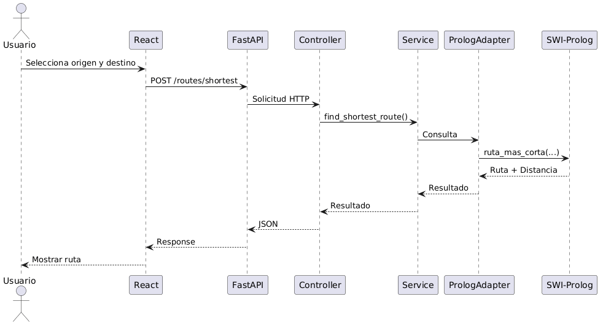
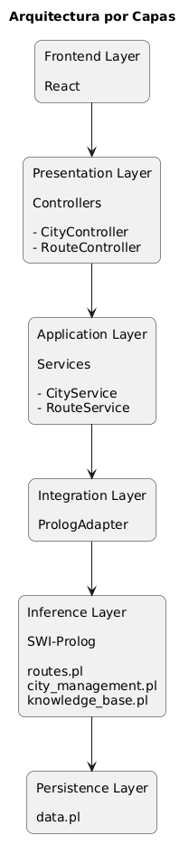

# Arquitectura del Sistema

## 1 Visión General

El sistema fue diseñado siguiendo una arquitectura híbrida compuesta por tres tecnologías principales:

* React para la interfaz gráfica.
* FastAPI para la exposición de servicios HTTP.
* SWI-Prolog para la representación del conocimiento y la inferencia lógica.

La decisión de utilizar esta arquitectura responde directamente a los requerimientos de la práctica, donde se establece que la lógica de búsqueda de rutas debe implementarse exclusivamente en Prolog, mientras que Python debe actuar únicamente como capa de integración.

En consecuencia, la aplicación se divide en dos responsabilidades claramente separadas:

Por un lado, el backend se encarga de recibir solicitudes HTTP, validar datos de entrada y comunicarse con Prolog.

Por otro lado, Prolog almacena el conocimiento del dominio y ejecuta todos los procesos de razonamiento necesarios para encontrar rutas, calcular distancias y determinar la mejor alternativa.

Esta separación permite mantener desacoplada la lógica de negocio de la lógica de inferencia.

---

# 2 Arquitectura por Capas

Para la implementación del backend se seleccionó el patrón arquitectónico **Layered Architecture (Arquitectura por Capas)**.

Este patrón divide la aplicación en niveles independientes donde cada capa tiene una responsabilidad específica.

La principal ventaja de esta aproximación es la reducción del acoplamiento entre componentes, facilitando el mantenimiento y la evolución del sistema.

La estructura implementada es la siguiente:

```text
Controllers
      │
      ▼
Services
      │
      ▼
Prolog Adapter
      │
      ▼
SWI-Prolog
```

Cada capa únicamente conoce la capa inmediatamente inferior.

Esto evita dependencias innecesarias y mejora la organización del proyecto.

---

# 3 Justificación del Patrón

La arquitectura por capas fue seleccionada por las siguientes razones:

### Separación de Responsabilidades

Cada componente posee una única función claramente definida.

Los controladores exponen endpoints.

Los servicios coordinan operaciones.

El adaptador encapsula la comunicación con Prolog.

Prolog implementa la inferencia lógica.

---

### Bajo Acoplamiento

Los controladores no conocen detalles internos de Prolog.

Si en el futuro cambia la forma de comunicación con el motor lógico, únicamente será necesario modificar el adaptador.

---

### Escalabilidad

La incorporación de nuevas funcionalidades puede realizarse agregando nuevos servicios y controladores sin modificar la estructura existente.

---

### Mantenibilidad

Los cambios realizados en una capa tienen un impacto mínimo sobre las demás.

Esto reduce la probabilidad de introducir errores durante el desarrollo.

---

# 2. Componentes del Backend

## 2.1 Capa Controller

La capa Controller representa el punto de entrada del sistema.

Su responsabilidad principal consiste en recibir solicitudes HTTP provenientes del frontend y transformarlas en llamadas a los servicios correspondientes.

Los controladores no contienen lógica de negocio ni lógica de inferencia.

Ejemplo:

```python
@router.post("/routes/shortest")
async def get_shortest_route(
    request: RouteRequest
):
    return route_service.find_shortest_route(
        request.origen,
        request.destino
    )
```

Responsabilidades:

* Exposición de endpoints.
* Recepción de solicitudes HTTP.
* Retorno de respuestas JSON.
* Manejo de errores HTTP.

---

## 2.2 Capa Service

La capa Service implementa la lógica de aplicación.

Actúa como intermediario entre los controladores y el adaptador de Prolog.

Su objetivo es coordinar operaciones y centralizar validaciones relacionadas con el flujo de la aplicación.

Ejemplo:

```python
def find_shortest_route(
    self,
    origen,
    destino
):
    result =
        self.adapter.find_shortest_route(
            origen,
            destino
        )

    if not result:
        raise ValueError(
            "No existe ruta"
        )

    return result
```

Responsabilidades:

* Orquestar operaciones.
* Aplicar reglas de negocio.
* Validar resultados.
* Gestionar excepciones.

---

## 2.3 Capa Schema

La capa Schema define los modelos de datos utilizados por FastAPI.

Estos modelos son implementados mediante Pydantic.

Ejemplo:

```python
class ConnectionRequest(
    BaseModel
):
    origen: str
    destino: str
    distancia: int
```

Responsabilidades:

* Validación automática.
* Conversión de tipos.
* Documentación automática mediante Swagger.
* Garantizar integridad de datos.

---

## 2.4 Capa Adapter

El adaptador constituye el elemento más importante de la integración.

Su función es traducir solicitudes Python a consultas Prolog y transformar las respuestas obtenidas en estructuras comprensibles para FastAPI.

Ejemplo:

```python
consulta =
    f"ruta_mas_corta("
    f"{o},{d},Ruta,Distancia)"
```

Posteriormente:

```python
resultados =
    list(
        self.prolog.query(
            consulta
        )
    )
```

Responsabilidades:

* Consultar SWI-Prolog.
* Ejecutar reglas lógicas.
* Convertir resultados.
* Gestionar persistencia.

---

# 3. Motor de Inferencia en Prolog

## 3.1 Rol de Prolog

Prolog constituye el núcleo inteligente del sistema.

A diferencia de Python, Prolog trabaja mediante razonamiento lógico sobre una base de conocimiento.

Toda operación relacionada con:

* búsqueda de rutas,
* cálculo de distancias,
* prevención de ciclos,
* optimización,

es ejecutada exclusivamente por Prolog.

Python no implementa ningún algoritmo de búsqueda.

Únicamente envía consultas y recibe respuestas.

Esto permite cumplir completamente con las restricciones definidas en la práctica.

---

## 3.2 Base de Conocimiento

La base de conocimiento está formada por hechos.

Ejemplo:

```prolog
ciudad(guatemala).

conexion(
    guatemala,
    antigua,
    45
).
```

Los hechos representan conocimiento explícito almacenado dentro del sistema.

---

## 3.3 Conocimiento Derivado

Además de hechos, se implementan reglas.

Las reglas permiten inferir nuevo conocimiento.

Ejemplo:

```prolog
camino(A,B,D) :-
    conexion(A,B,D).

camino(A,B,D) :-
    conexion(B,A,D).
```

Esta regla permite transformar automáticamente las conexiones en bidireccionales.

---

## 3.4 Búsqueda de Rutas

La búsqueda se implementa mediante recursividad.

```prolog
ruta(
    Origen,
    Destino,
    Ruta,
    Distancia
).
```

El algoritmo explora todos los caminos posibles entre dos ciudades.

Cada recorrido genera:

* una lista de ciudades visitadas,
* una distancia acumulada.

---

## 3.5 Prevención de Ciclos

Uno de los requisitos de la práctica consiste en evitar ciudades repetidas.

Para ello se utiliza:

```prolog
\+ member(
    Siguiente,
    Visitadas
).
```

Esta condición impide visitar una ciudad previamente recorrida.

Gracias a esta validación se eliminan ciclos infinitos.

---

## 3.6 Ruta Más Corta

La optimización se implementa mediante:

```prolog
setof(
    Distancia-Ruta,
    ruta(...),
    Rutas
).
```

La función `setof/3` ordena automáticamente las soluciones encontradas.

Por esta razón la primera solución corresponde siempre a la ruta con menor distancia.

```prolog
[
 DistanciaCorta-RutaCorta
 | _
]
```

De esta forma no es necesario implementar algoritmos adicionales en Python.

---

# 3. Persistencia de Datos

La práctica prohíbe el uso de bases de datos.

Para resolver este problema se implementó un mecanismo de persistencia basado en archivos Prolog.

La información permanente se almacena dentro de:

```text
prolog/data.pl
```

Ejemplo:

```prolog
ciudad(quiche).

conexion(
    quiche,
    huehuetenango,
    120
).
```

Cuando el sistema inicia:

```prolog
:- consult('data.pl').
```

Toda la información es cargada automáticamente.

Al agregar nuevas ciudades o conexiones:

1. Se ejecuta la regla Prolog.
2. Se actualiza la memoria de ejecución.
3. Se escribe el nuevo hecho en `data.pl`.

Este mecanismo permite conservar información incluso después de reiniciar la aplicación.

---

# 8. Flujo de Ejecución

## Consulta de Ruta Más Corta



# 9. Diagrama General de Arquitectura




Estos diagramas muestran tanto el flujo dinámico de una consulta como la estructura estática completa de la solución implementada.
