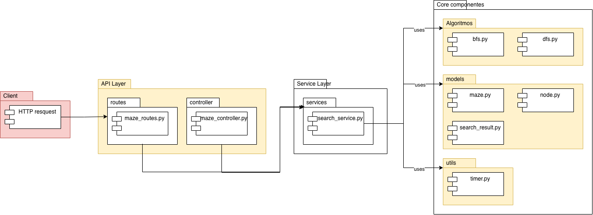

# RoboMaze — Documentación General del Backend

## Descripción del Proyecto

**RoboMaze** es un sistema que representa laberintos virtuales y permite a un agente inteligente encontrar rutas desde un punto inicial hasta un destino usando algoritmos de búsqueda (**BFS** y **DFS**). El backend está desarrollado íntegramente en Python con Flask y expone una API REST.

## Patrón Arquitectónico Aplicado

Se aplica el patrón **Service Layer** con una variante de **MVC**:



### Ventajas del patrón
- El controlador **no conoce** los algoritmos; solo habla con el servicio.
- Los algoritmos **no conocen** Flask; solo reciben un `Maze` y retornan datos.
- Facilita testing unitario de cada capa por separado.

---

## Descripción de Cada Archivo

### `app.py`
**Rol:** Punto de entrada de la aplicación.

Crea la instancia de Flask mediante la *factory function* `create_app()`, habilita CORS para que el frontend (en otro origen) pueda consumir la API, y registra el Blueprint de rutas. Al ejecutarse directamente, arranca el servidor de desarrollo en `0.0.0.0:5000`.

---

### `algorithms/bfs.py`
**Rol:** Implementación del algoritmo *Breadth-First Search*.

| Aspecto | Detalle |
|---------|---------|
| Estructura de datos | Cola FIFO (`collections.deque`) |
| Garantía | Camino más corto en número de pasos |
| Complejidad tiempo | O(V + E) |
| Complejidad espacio | O(V) |
| Movimientos | 4-conectividad (arriba, abajo, izquierda, derecha) |

Función principal: `bfs(maze: Maze) → (path, explored)`.  
Retorna la ruta como lista de coordenadas `(row, col)` y el orden de exploración completo para su visualización en el frontend.

---

### `algorithms/dfs.py`
**Rol:** Implementación del algoritmo *Depth-First Search* **iterativo**.

| Aspecto | Detalle |
|---------|---------|
| Estructura de datos | Pila LIFO (lista Python con `append`/`pop`) |
| Garantía | Encuentra una ruta (no necesariamente la más corta) |
| Complejidad tiempo | O(V + E) |
| Complejidad espacio | O(V) |
| Nota | Implementación iterativa evita desbordamiento de pila en grids grandes |

Función principal: `dfs(maze: Maze) → (path, explored)`.

---

### `models/node.py`
**Rol:** Entidad atómica del espacio de estados.

Representa una celda `(row, col)` del laberinto. Incluye referencia al nodo `parent` para reconstruir la ruta al llegar al destino. Implementa `__eq__` y `__hash__` para poder usarse en conjuntos `visited` de forma eficiente.

---

### `models/maze.py`
**Rol:** Modelo del laberinto.

Contiene la cuadrícula bidimensional (`List[List[int]]`), las posiciones de inicio y destino, y los métodos:
- `is_valid(row, col)` — límites del grid.
- `is_free(row, col)` — celda transitable.
- `get_neighbors(node)` — vecinos 4-conectados transitables.
- `validate()` — lanza `ValueError` si el estado es inválido.
- `from_dict(data)` — constructor desde payload JSON.

Convención: `0` = celda libre, `1` = pared/obstáculo.

---

### `models/search_result.py`
**Rol:** DTO (*Data Transfer Object*) de resultado de búsqueda.

Encapsula todo lo que necesita el frontend tras ejecutar un algoritmo:

| Campo | Tipo | Descripción |
|-------|------|-------------|
| `algorithm` | `str` | "BFS" o "DFS" |
| `found` | `bool` | Si se encontró ruta |
| `path` | `list` | Coordenadas de la ruta |
| `explored` | `list` | Coordenadas visitadas en orden |
| `nodes_explored` | `int` | Conteo de nodos visitados |
| `path_length` | `int` | Longitud de la ruta |
| `execution_time_ms` | `float` | Tiempo en milisegundos |
| `message` | `str` | Mensaje descriptivo |

---

### `services/search_service.py`
**Rol:** Capa de servicio — lógica de negocio completa.

Métodos principales:

| Método | Descripción |
|--------|-------------|
| `run_bfs(maze_data)` | Valida, ejecuta BFS y retorna `SearchResult` |
| `run_dfs(maze_data)` | Valida, ejecuta DFS y retorna `SearchResult` |
| `run_both(maze_data)` | Ejecuta ambos y retorna comparación estadística |
| `list_predefined()` | Lista los 6 laberintos predefinidos |
| `get_predefined(id)` | Retorna un laberinto predefinido por ID |
| `generate_maze(rows, cols, density)` | Genera laberinto aleatorio con ruta garantizada |
| `export_csv(results)` | Convierte resultados a CSV en memoria |
| `export_pdf(results)` | Genera PDF con ReportLab |

Incluye **6 laberintos predefinidos** (`maze_1` … `maze_6`), cubriendo: básico, zigzag, sin solución, complejo 10×10, espiral y abierto.

---

### `controllers/maze_controller.py`
**Rol:** Controlador HTTP.

Cada función corresponde a un endpoint. Responsabilidades:
1. Extraer el body JSON con `request.get_json()`.
2. Validar presencia mínima de datos.
3. Llamar al método correspondiente del `SearchService`.
4. Retornar `jsonify(...)` con el código HTTP apropiado.
5. Capturar errores y retornar respuestas de error estructuradas.

No contiene lógica de negocio.

---

### `routes/maze_routes.py`
**Rol:** Tabla de enrutamiento (Blueprint Flask).

Mapea cada combinación `(método HTTP, URL)` a su función controladora. Usa `url_prefix="/api"` para que todas las rutas tengan el prefijo `/api/`.

---

### `utils/timer.py`
**Rol:** Temporizador de alta precisión.

Usa `time.perf_counter()` (reloj de más alta resolución disponible en Python) para medir tiempos en microsegundos, reportados en milisegundos.

Dos modos de uso:
- **Context manager:** `with Timer() as t: ... → t.elapsed_ms`
- **Función estática:** `elapsed_ms, result = Timer.measure(fn, *args)`

---

## Instalación y Ejecución

### Requisitos
- Python 3.10 o superior
- pip

### Pasos

```bash
# 1. Navegar al directorio backend
cd practica4/backend

# 2. Crear entorno virtual (recomendado)
python -m venv venv
source venv/bin/activate          # unix

# 3. Instalar dependencias
pip install -r requirements.txt

# 4. Iniciar el servidor
python app.py
```

El servidor quedará disponible en `http://localhost:5000`.

### Con Docker (opcional)

```dockerfile
FROM python:3.11-slim
WORKDIR /app
COPY requirements.txt .
RUN pip install --no-cache-dir -r requirements.txt
COPY . .
EXPOSE 5000
CMD ["python", "app.py"]
```

```bash
docker build -t robomaze-backend .
docker run -p 5000:5000 robomaze-backend
```

---

## Dependencias (`requirements.txt`)

| Librería | Versión | Uso |
|----------|---------|-----|
| `flask` | 3.0.3 | Framework web y API REST |
| `flask-cors` | 4.0.1 | Habilitar CORS para el frontend |
| `reportlab` | 4.2.2 | Generación de archivos PDF |

> **Nota:** No se usan bases de datos ni librerías de pathfinding automático, cumpliendo con las restricciones de la práctica.

---

# RoboMaze — Documentación de Endpoints API

**Base URL:** `http://localhost:5000/api`  
**Content-Type:** `application/json` (en todos los POST)  
**CORS:** Habilitado para todos los orígenes.

---

## Índice de Endpoints

| Método | Ruta | Descripción |
|--------|------|-------------|
| GET | `/api/health` | Estado del servidor |
| POST | `/api/search/bfs` | Ejecutar BFS |
| POST | `/api/search/dfs` | Ejecutar DFS |
| POST | `/api/search/both` | Ejecutar BFS + DFS con comparación |
| GET | `/api/mazes/predefined` | Listar laberintos predefinidos |
| GET | `/api/mazes/predefined/{id}` | Obtener laberinto predefinido |
| POST | `/api/mazes/generate` | Generar laberinto aleatorio |
| POST | `/api/export/csv` | Exportar resultados a CSV |
| POST | `/api/export/pdf` | Exportar resultados a PDF |

---

## Esquema del Laberinto (compartido)

Todos los endpoints de búsqueda y algunos de generación usan este esquema como entrada:

```json
{
  "grid": [
    [0, 1, 0, 0, 0],
    [0, 1, 0, 1, 0],
    [0, 0, 0, 1, 0],
    [0, 1, 1, 1, 0],
    [0, 0, 0, 0, 0]
  ],
  "start": { "row": 0, "col": 0 },
  "end":   { "row": 4, "col": 4 }
}
```

| Campo | Tipo | Descripción |
|-------|------|-------------|
| `grid` | `int[][]` | Matriz 2D. `0` = libre, `1` = pared |
| `start.row` | `int` | Fila del punto de inicio (0-indexado) |
| `start.col` | `int` | Columna del punto de inicio (0-indexado) |
| `end.row` | `int` | Fila del punto destino (0-indexado) |
| `end.col` | `int` | Columna del punto destino (0-indexado) |

---

## Esquema de Resultado de Búsqueda (compartido)

Todos los endpoints de búsqueda retornan este esquema (o una combinación):

```json
{
  "algorithm": "BFS",
  "found": true,
  "path": [
    { "row": 0, "col": 0 },
    { "row": 1, "col": 0 },
    { "row": 4, "col": 4 }
  ],
  "explored": [
    { "row": 0, "col": 0 },
    { "row": 1, "col": 0 }
  ],
  "nodes_explored": 12,
  "path_length": 9,
  "execution_time_ms": 0.2341,
  "message": "Ruta encontrada."
}
```

| Campo | Tipo | Descripción |
|-------|------|-------------|
| `algorithm` | `string` | `"BFS"` o `"DFS"` |
| `found` | `boolean` | `true` si se encontró una ruta |
| `path` | `{row,col}[]` | Coordenadas de la ruta, de inicio a destino |
| `explored` | `{row,col}[]` | Todos los nodos visitados, en orden de visita |
| `nodes_explored` | `int` | Cantidad total de nodos explorados |
| `path_length` | `int` | Número de celdas en la ruta (0 si no hay ruta) |
| `execution_time_ms` | `float` | Tiempo de ejecución en milisegundos |
| `message` | `string` | Mensaje descriptivo del resultado |

---

## Endpoints

---

### `GET /api/health`

Verificación de estado del servidor.

**Request:** Sin body.

**Response 200 OK:**
```json
{
  "status": "ok",
  "service": "RoboMaze API"
}
```

---

### `POST /api/search/bfs`

Ejecuta el algoritmo **Breadth-First Search** sobre el laberinto proporcionado.  
Garantiza encontrar el **camino más corto** en número de pasos.

**Request Body:**
```json
{
  "grid": [
    [0, 1, 0, 0, 0],
    [0, 1, 0, 1, 0],
    [0, 0, 0, 1, 0],
    [0, 1, 1, 1, 0],
    [0, 0, 0, 0, 0]
  ],
  "start": { "row": 0, "col": 0 },
  "end":   { "row": 4, "col": 4 }
}
```

**Response 200 OK — ruta encontrada:**
```json
{
  "algorithm": "BFS",
  "found": true,
  "path": [
    { "row": 0, "col": 0 },
    { "row": 1, "col": 0 },
    { "row": 2, "col": 0 },
    { "row": 2, "col": 1 },
    { "row": 2, "col": 2 },
    { "row": 1, "col": 2 },
    { "row": 0, "col": 2 },
    { "row": 0, "col": 3 },
    { "row": 0, "col": 4 },
    { "row": 1, "col": 4 },
    { "row": 2, "col": 4 },
    { "row": 3, "col": 4 },
    { "row": 4, "col": 4 }
  ],
  "explored": [ ... ],
  "nodes_explored": 18,
  "path_length": 13,
  "execution_time_ms": 0.1823,
  "message": "Ruta encontrada."
}
```

**Response 200 OK — sin ruta:**
```json
{
  "algorithm": "BFS",
  "found": false,
  "path": [],
  "explored": [ ... ],
  "nodes_explored": 8,
  "path_length": 0,
  "execution_time_ms": 0.0912,
  "message": "No existe ruta entre el inicio y el destino."
}
```

**Response 422 Unprocessable Entity — datos inválidos:**
```json
{
  "error": "El inicio {0, 0} está sobre una pared."
}
```

**Response 400 Bad Request — body vacío:**
```json
{
  "error": "Body JSON requerido."
}
```

---

### `POST /api/search/dfs`

Ejecuta el algoritmo **Depth-First Search** sobre el laberinto proporcionado.  
Puede encontrar una ruta más rápido en algunos laberintos, pero **no garantiza** el camino más corto.

**Request Body:** Idéntico a `/api/search/bfs`.

```json
{
  "grid": [
    [0, 1, 0, 0, 0],
    [0, 1, 0, 1, 0],
    [0, 0, 0, 1, 0],
    [0, 1, 1, 1, 0],
    [0, 0, 0, 0, 0]
  ],
  "start": { "row": 0, "col": 0 },
  "end":   { "row": 4, "col": 4 }
}
```

**Response 200 OK — ruta encontrada:**
```json
{
  "algorithm": "DFS",
  "found": true,
  "path": [
    { "row": 0, "col": 0 },
    { "row": 1, "col": 0 },
    { "row": 2, "col": 0 },
    { "row": 2, "col": 1 },
    { "row": 2, "col": 2 },
    { "row": 1, "col": 2 },
    { "row": 0, "col": 2 },
    { "row": 0, "col": 3 },
    { "row": 0, "col": 4 },
    { "row": 1, "col": 4 },
    { "row": 2, "col": 4 },
    { "row": 3, "col": 4 },
    { "row": 4, "col": 4 }
  ],
  "explored": [ ... ],
  "nodes_explored": 22,
  "path_length": 13,
  "execution_time_ms": 0.2105,
  "message": "Ruta encontrada."
}
```

**Códigos de error:** Idénticos a `/api/search/bfs`.

---

### `POST /api/search/both`

Ejecuta **BFS y DFS** sobre el mismo laberinto en una sola llamada y retorna los resultados con **estadísticas comparativas**.

**Request Body:** Idéntico a `/api/search/bfs`.

```json
{
  "grid": [
    [0, 1, 0, 0, 0],
    [0, 1, 0, 1, 0],
    [0, 0, 0, 1, 0],
    [0, 1, 1, 1, 0],
    [0, 0, 0, 0, 0]
  ],
  "start": { "row": 0, "col": 0 },
  "end":   { "row": 4, "col": 4 }
}
```

**Response 200 OK:**
```json
{
  "bfs": {
    "algorithm": "BFS",
    "found": true,
    "path": [ ... ],
    "explored": [ ... ],
    "nodes_explored": 18,
    "path_length": 13,
    "execution_time_ms": 0.1823,
    "message": "Ruta encontrada."
  },
  "dfs": {
    "algorithm": "DFS",
    "found": true,
    "path": [ ... ],
    "explored": [ ... ],
    "nodes_explored": 22,
    "path_length": 13,
    "execution_time_ms": 0.2105,
    "message": "Ruta encontrada."
  },
  "comparison": {
    "faster_algorithm": "BFS",
    "fewer_nodes_explored": "BFS",
    "shorter_path": "empate",
    "bfs_time_ms": 0.1823,
    "dfs_time_ms": 0.2105,
    "bfs_nodes": 18,
    "dfs_nodes": 22,
    "bfs_path_length": 13,
    "dfs_path_length": 13,
    "note": "BFS garantiza el camino más corto; DFS puede explorar menos nodos pero no garantiza optimalidad."
  }
}
```

**Campos del bloque `comparison`:**

| Campo | Tipo | Descripción |
|-------|------|-------------|
| `faster_algorithm` | `string` | Algoritmo con menor tiempo de ejecución |
| `fewer_nodes_explored` | `string` | Algoritmo que exploró menos nodos |
| `shorter_path` | `string` | Algoritmo con ruta más corta (`"empate"` si igual) |
| `bfs_time_ms` | `float` | Tiempo BFS en ms |
| `dfs_time_ms` | `float` | Tiempo DFS en ms |
| `bfs_nodes` | `int` | Nodos explorados por BFS |
| `dfs_nodes` | `int` | Nodos explorados por DFS |
| `bfs_path_length` | `int` | Longitud de ruta BFS |
| `dfs_path_length` | `int` | Longitud de ruta DFS |
| `note` | `string` | Observación comparativa |

---

### `GET /api/mazes/predefined`

Lista todos los laberintos predefinidos disponibles con su metadata.  
**No** retorna el grid completo (usar el endpoint individual para eso).

**Request:** Sin body.

**Response 200 OK:**
```json
{
  "total": 6,
  "mazes": [
    {
      "id": "maze_1",
      "name": "Laberinto Básico 5×5",
      "description": "Laberinto sencillo de 5 filas × 5 columnas.",
      "rows": 5,
      "cols": 5
    },
    {
      "id": "maze_2",
      "name": "Laberinto Zigzag 7×7",
      "description": "Camino en zigzag que prueba el orden de exploración.",
      "rows": 7,
      "cols": 7
    },
    {
      "id": "maze_3",
      "name": "Laberinto Sin Solución 5×5",
      "description": "No existe ruta entre inicio y destino. Prueba el manejo de error.",
      "rows": 5,
      "cols": 5
    },
    {
      "id": "maze_4",
      "name": "Laberinto Complejo 10×10",
      "description": "Laberinto más grande con múltiples caminos alternativos.",
      "rows": 10,
      "cols": 10
    },
    {
      "id": "maze_5",
      "name": "Laberinto Espiral 8×8",
      "description": "Estructura en espiral que favorece a DFS sobre BFS.",
      "rows": 8,
      "cols": 8
    },
    {
      "id": "maze_6",
      "name": "Laberinto Abierto 6×6",
      "description": "Pocos obstáculos, múltiples rutas posibles.",
      "rows": 6,
      "cols": 6
    }
  ]
}
```

---

### `GET /api/mazes/predefined/{maze_id}`

Retorna el laberinto predefinido completo, listo para enviar a `/api/search/bfs` o `/api/search/dfs`.

**Path param:**

| Parámetro | Valores válidos |
|-----------|----------------|
| `maze_id` | `maze_1`, `maze_2`, `maze_3`, `maze_4`, `maze_5`, `maze_6` |

**Request:** Sin body.

**Response 200 OK:**
```json
{
  "name": "Laberinto Básico 5×5",
  "description": "Laberinto sencillo de 5 filas × 5 columnas.",
  "grid": [
    [0, 1, 0, 0, 0],
    [0, 1, 0, 1, 0],
    [0, 0, 0, 1, 0],
    [0, 1, 1, 1, 0],
    [0, 0, 0, 0, 0]
  ],
  "start": { "row": 0, "col": 0 },
  "end":   { "row": 4, "col": 4 }
}
```

**Response 404 Not Found:**
```json
{
  "error": "Laberinto 'maze_99' no encontrado."
}
```

---

### `POST /api/mazes/generate`

Genera un laberinto aleatorio garantizando que exista una ruta válida entre inicio `(0,0)` y destino `(rows-1, cols-1)`.

**Request Body:**
```json
{
  "rows": 10,
  "cols": 10,
  "density": 0.30
}
```

| Campo | Tipo | Default | Rango | Descripción |
|-------|------|---------|-------|-------------|
| `rows` | `int` | `10` | `[3, 30]` | Número de filas |
| `cols` | `int` | `10` | `[3, 30]` | Número de columnas |
| `density` | `float` | `0.30` | `[0.0, 0.6]` | Proporción de paredes. Valores altos generan laberintos más difíciles |

**Response 200 OK:**
```json
{
  "rows": 10,
  "cols": 10,
  "grid": [
    [0, 0, 1, 0, 0, 0, 0, 0, 1, 0],
    [0, 1, 0, 0, 1, 0, 1, 0, 0, 0],
    ...
  ],
  "start": { "row": 0, "col": 0 },
  "end":   { "row": 9, "col": 9 }
}
```

**Response 422 Unprocessable Entity:**
```json
{
  "error": "No se pudo generar un laberinto con ruta válida. Prueba con menor densidad de paredes."
}
```

---

### `POST /api/export/csv`

Recibe los resultados de búsqueda y retorna un archivo `.csv` para descarga.

Acepta el resultado de `/api/search/bfs`, `/api/search/dfs` o `/api/search/both`.

**Request Body (resultado de `/api/search/both`):**
```json
{
  "bfs": {
    "algorithm": "BFS",
    "found": true,
    "path": [ ... ],
    "explored": [ ... ],
    "nodes_explored": 18,
    "path_length": 13,
    "execution_time_ms": 0.1823,
    "message": "Ruta encontrada."
  },
  "dfs": {
    "algorithm": "DFS",
    "found": true,
    "path": [ ... ],
    "explored": [ ... ],
    "nodes_explored": 22,
    "path_length": 13,
    "execution_time_ms": 0.2105,
    "message": "Ruta encontrada."
  },
  "comparison": { ... }
}
```

**Request Body (resultado individual):**
```json
{
  "algorithm": "BFS",
  "found": true,
  "path": [ ... ],
  "explored": [ ... ],
  "nodes_explored": 18,
  "path_length": 13,
  "execution_time_ms": 0.1823,
  "message": "Ruta encontrada."
}
```

**Response 200 OK:**
```
Content-Type: text/csv
Content-Disposition: attachment; filename=robomaze_results.csv

RoboMaze - Resultados de Búsqueda

=== BFS ===
Algoritmo,BFS
Ruta encontrada,True
Nodos explorados,18
Longitud de ruta,13
Tiempo de ejecución (ms),0.1823
Mensaje,Ruta encontrada.

Ruta (row, col)
0,0
1,0
...
```

---

### `POST /api/export/pdf`

Recibe los resultados de búsqueda y retorna un archivo `.pdf` generado con ReportLab.

**Request Body:** Idéntico a `/api/export/csv`.

**Response 200 OK:**
```
Content-Type: application/pdf
Content-Disposition: attachment; filename=robomaze_results.pdf

<binary PDF content>
```

**Response 400 Bad Request:**
```json
{
  "error": "Body JSON con resultados requerido."
}
```

**Response 500 Internal Server Error:**
```json
{
  "error": "Error interno: ..."
}
```

---

## Códigos de Estado HTTP

| Código | Significado |
|--------|-------------|
| `200` | Éxito. Incluye búsquedas sin ruta (`found: false`) que son resultados válidos |
| `400` | Bad Request — body JSON ausente o malformado |
| `404` | Not Found — recurso no encontrado (ej. maze_id inválido) |
| `422` | Unprocessable Entity — datos semánticamente inválidos (inicio en pared, etc.) |
| `500` | Internal Server Error — error inesperado del servidor |

---

## Flujo Típico de Uso

```
1. GET  /api/mazes/predefined          → elegir un laberinto de la lista
2. GET  /api/mazes/predefined/maze_4   → obtener el grid completo
3. POST /api/search/both               → ejecutar BFS y DFS con comparación
4. POST /api/export/pdf                → descargar reporte con los resultados
```

O con laberinto personalizado:

```
1. POST /api/mazes/generate  { rows: 15, cols: 15, density: 0.35 }
2. POST /api/search/bfs      { grid: [...], start: {...}, end: {...} }
3. POST /api/search/dfs      { grid: [...], start: {...}, end: {...} }
4. POST /api/export/csv      { bfs: {...}, dfs: {...} }
```

---

## Ejemplo con cURL

```bash
# Ejecutar BFS en laberinto básico
curl -X POST http://localhost:5000/api/search/bfs \
  -H "Content-Type: application/json" \
  -d '{
    "grid": [[0,1,0],[0,0,0],[0,1,0]],
    "start": {"row": 0, "col": 0},
    "end":   {"row": 2, "col": 2}
  }'

# Obtener laberinto predefinido
curl http://localhost:5000/api/mazes/predefined/maze_4

# Generar laberinto aleatorio
curl -X POST http://localhost:5000/api/mazes/generate \
  -H "Content-Type: application/json" \
  -d '{"rows": 12, "cols": 12, "density": 0.25}'
```