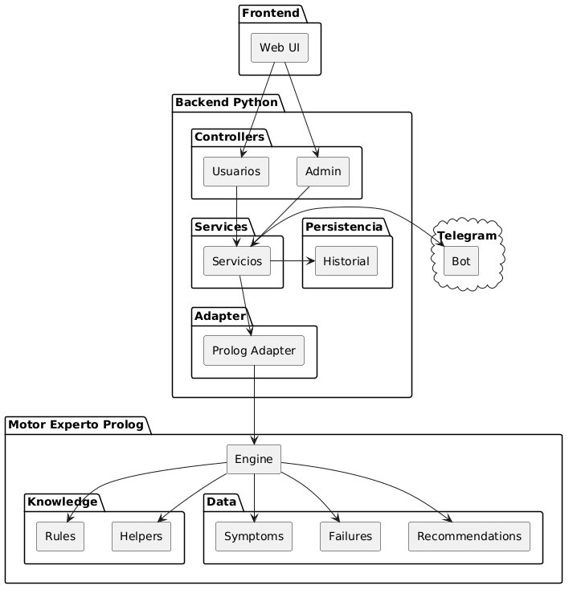

# Doctor Byte — Manual Técnico

**Sistema Experto para Diagnóstico de Fallas en Computadoras**

---

## 1. Descripción General del Sistema

Doctor Byte es un sistema experto orientado al diagnóstico preliminar de fallas comunes en computadoras. El usuario selecciona síntomas observados en su equipo a través de una interfaz web y el sistema devuelve uno o más diagnósticos con sus respectivas recomendaciones. Toda la lógica de inferencia reside en un motor Prolog que evalúa reglas de conocimiento; el backend Python actúa únicamente como intermediario entre la interfaz y dicho motor.

El sistema está dividido en cuatro capas bien delimitadas: motor de inferencia (Prolog), adaptador (pyswip), servicios Python y controladores HTTP (FastAPI). Esta separación garantiza que agregar nuevas reglas o síntomas no requiera modificar código Python, y que los endpoints HTTP no contengan lógica de dominio.

---

## 2. Arquitectura de Capas

### 2.1 Visión General



El proyecto adopta una arquitectura de cuatro capas con responsabilidades estrictamente definidas. Cada capa se comunica únicamente con la capa adyacente, lo que facilita el reemplazo o la extensión de cualquier componente sin afectar al resto del sistema.

| Capa | Componente | Responsabilidad |
|---|---|---|
| 1 — Motor | `prolog/engine.pl` | Inferencia, reglas de diagnóstico y persistencia de hechos. |
| 2 — Adaptador | `prolog_adapter.py` | Puente Python ↔ Prolog vía pyswip. Serialización y persistencia de archivos `.pl`. |
| 3 — Servicios | `services/usuarios.py`, `services/admin.py` | Lógica de negocio: orquestación del diagnóstico, manejo de historial, validaciones de dominio y notificación Telegram. |
| 4 — Controladores | `controllers/usuarios.py`, `controllers/admin.py` | Endpoints HTTP con FastAPI. Validan request con Pydantic y traducen respuestas del servicio a códigos HTTP. |

### 2.2 Flujo de Diagnóstico

Cuando el usuario selecciona síntomas y presiona Diagnosticar, la solicitud llega al endpoint `POST /api/diagnosticar` del controlador. El controlador valida el body con el modelo Pydantic `DiagnosticarRequest` y lo pasa al servicio. El servicio llama a `prolog.diagnosticar(sintomas)` del adaptador, que construye una consulta Prolog del tipo `diagnosticar_todos(['S01','S11'], Lista)` y la evalúa contra el motor. Prolog recorre las reglas `diagnostico/2` en `rules.pl` usando el predicado `subset/2` para verificar que todos los síntomas requeridos por una regla estén presentes en los seleccionados; los resultados pasan por `eliminar_duplicados_falla/2` para evitar reportar la misma falla dos veces.

El servicio recibe la lista de diagnósticos, genera un UUID para el registro, construye la entrada del historial con timestamp ISO 8601 y la persiste haciendo append al archivo `historial.json`. A continuación invoca el servicio de Telegram para notificar el resultado. Finalmente devuelve el dict al controlador, que lo emite como JSON con status 200.

---

## 3. Estructura de Archivos

| Ruta | Descripción |
|---|---|
| `prolog/engine.pl` | Punto de entrada. Carga todos los módulos y expone predicados públicos. |
| `prolog/knowledge/rules.pl` | Reglas de diagnóstico: `diagnostico(FallaID, [Síntomas])`. |
| `prolog/knowledge/helpers.pl` | Predicados utilitarios: `subset/2`, `interseccion/3`, wrappers de `findall`. |
| `prolog/data/symptoms.pl` | Hechos `sintoma/3`. Modificado por el CRUD del admin. |
| `prolog/data/failures.pl` | Hechos `falla/4`. Modificado por el CRUD del admin. |
| `prolog/data/recommendations.pl` | Hechos `recomendacion/3`. Modificado por el CRUD del admin. |
| `backend/app/adapter/prolog_adapter.py` | Singleton Prolog + métodos CRUD con persistencia en archivos `.pl`. |
| `backend/app/services/usuarios.py` | Orquestación del diagnóstico, historial y llamada a Telegram. |
| `backend/app/services/admin.py` | CRUD de síntomas, fallas, recomendaciones y reglas con validaciones. |
| `backend/app/services/telegram.py` | Construcción y envío de mensajes al bot de Telegram. |
| `backend/app/controllers/usuarios.py` | Endpoints HTTP del usuario: `/diagnosticar`, `/sintomas`, `/historial`. |
| `backend/app/controllers/admin.py` | Endpoints HTTP del admin: `/admin/sintomas`, `/fallas`, `/reglas`, etc. |
| `backend/app/services/historial/historial.json` | Array JSON de diagnósticos persistidos. Nunca se sobreescribe completo. |

---

## 4. Motor de Inferencia — Prolog

### 4.1 Base de Conocimiento

La base de conocimiento está dividida en datos (hechos) y conocimiento (reglas). Los hechos representan el estado del mundo: qué síntomas, fallas y recomendaciones existen. Las reglas codifican el razonamiento experto: qué combinaciones de síntomas llevan a qué falla.

Todos los hechos están declarados con `:- dynamic`, lo que permite que el adaptador Python los modifique en tiempo de ejecución con `assertz` y `retract`. Esta es la base del CRUD del administrador: no se reinicia el proceso Prolog, sino que los hechos se actualizan en memoria y el adaptador también reescribe el archivo `.pl` correspondiente para mantener la persistencia entre reinicios.

### 4.2 Predicados Clave

**`diagnosticar_todos/2`**

Es el predicado público principal, el único que el adaptador consulta para el diagnóstico. Recibe una lista de IDs de síntomas y devuelve todos los diagnósticos aplicables sin duplicados. Internamente usa `findall/3` para recolectar todas las soluciones de `diagnosticar/6`, que a su vez cruza cada regla `diagnostico/2` con los síntomas seleccionados mediante `subset/2`. El resultado pasa por `eliminar_duplicados_falla/2`, que usa un acumulador de IDs visitados y un corte (`!`) para descartar la segunda aparición de una misma falla.

**`subset/2`**

Predicado recursivo en `helpers.pl` que verifica que todos los elementos de una lista pertenezcan a un conjunto. Es el núcleo lógico del diagnóstico: una regla se activa solo si TODOS sus síntomas requeridos están presentes en los síntomas seleccionados por el usuario. Si el usuario seleccionó más síntomas de los que requiere la regla, la regla igual se activa porque `subset` no exige igualdad, solo contenencia.

**`agregar_regla/2` y `eliminar_regla/2`**

Permiten modificar la base de conocimiento en tiempo de ejecución. `agregar_regla` usa `\+ diagnostico(FallaID, ListaSintomas)` para no insertar duplicados antes de llamar a `assertz`. El adaptador Python complementa esto reescribiendo el archivo `rules.pl` para que el cambio sobreviva un reinicio del servidor.

---

## 5. Adaptador Python — `prolog_adapter.py`

El adaptador es el puente entre el mundo Python y el motor Prolog. Utiliza la librería `pyswip`, que expone SWI-Prolog como una librería C embebida dentro del proceso Python, eliminando la necesidad de lanzar un proceso hijo o comunicarse por socket.

**Singleton thread-safe.** La instancia de Prolog se crea una sola vez con `get_prolog()` usando doble verificación de bloqueo sobre `threading.Lock`. Esto es necesario porque pyswip no es seguro para múltiples instancias simultáneas. La función `reload_prolog()` permite forzar una recarga completa del engine después de modificar archivos `.pl` manualmente.

**Serialización de tipos pyswip.** pyswip retorna los resultados como objetos `Atom` y `Functor`, no como strings Python. Los helpers `_atom()` y `_list_from_prolog()` realizan la conversión. Para los diagnósticos, cada elemento retornado por `diagnosticar_todos/2` es un `Functor` con cinco argumentos; el adaptador los desempaqueta accediendo a `term.args`.

**Persistencia del CRUD.** Cada operación de CRUD tiene dos efectos: primero modifica Prolog en memoria con `assertz` o `retract`, y luego modifica el archivo `.pl` correspondiente. Las funciones `_persist_*` hacen append al archivo; `_remove_fact_from_file` usa una expresión regular con `re.sub` para eliminar el bloque del hecho. Esta estrategia evita reescribir el archivo completo en cada operación, reduciendo el riesgo de corrupción ante fallos durante la escritura.

---

## 6. Capa de Servicios

**`services/usuarios.py`** contiene la función `diagnosticar(sintomas, usuario)` que orquesta el flujo completo. Llama al adaptador, construye la entrada del historial con `uuid.uuid4()` y `datetime.now()`, y la persiste mediante `_guardar_entrada()`. Esta función lee el archivo `historial.json` completo, añade la nueva entrada al array y reescribe el archivo; nunca sobreescribe entradas existentes.

**`services/admin.py`** implementa el CRUD de síntomas, fallas, recomendaciones y reglas. Todos los métodos siguen el mismo patrón: verificar existencia consultando el adaptador, llamar al adaptador para la operación, y retornar un dict con clave `ok` (booleano) y `motivo` (string de error). Esta convención permite que el controlador decida el status HTTP adecuado sin conocer los detalles de la validación. El método `crear_regla` es el más complejo: primero valida que la falla exista, luego que todos los síntomas listados existan, y finalmente que no haya una regla idéntica.

---

## 7. Capa de Controladores — FastAPI

Los controladores son `APIRouter` de FastAPI. `controllers/usuarios.py` contiene los endpoints del flujo usuario y `controllers/admin.py` los del administrador con el prefijo `/admin`. Ambos se registran en `main.py` con `app.include_router()`.

La validación de entrada se realiza con modelos Pydantic. Por ejemplo, `DiagnosticarRequest` tiene un validador `@field_validator("sintomas")` que lanza `ValueError` si la lista está vacía; FastAPI convierte ese error en una respuesta 422 automáticamente. Para las respuestas de error del servicio, el helper `_error(motivo, status)` centraliza la construcción de `JSONResponse` con el formato estándar `{"error": "..."}`. La decisión del status code (400, 404 o 409) se basa en el texto del motivo retornado por el servicio.

Registro en `main.py`:

```python
from app.controllers.usuarios import router as usuarios_router
from app.controllers.admin import router as admin_router

app.include_router(usuarios_router, prefix="/api")
app.include_router(admin_router, prefix="/api")
```

---

## 8. Historial de Diagnósticos

El historial se almacena como un array JSON en `backend/app/services/historial/historial.json`. Cada entrada tiene la siguiente estructura:

```json
{
  "id": "550e8400-e29b-41d4-a716-446655440000",
  "fecha": "2026-06-10T14:32:00",
  "usuario": "Juan Pérez",
  "sintomas_seleccionados": ["S01", "S03", "S11"],
  "diagnosticos": [
    {
      "falla_id": "F02",
      "nombre": "Sobrecalentamiento del sistema",
      "tipo": "Hardware",
      "descripcion": "El equipo presenta temperaturas excesivas...",
      "recomendaciones": [
        "Limpiar ventiladores internos...",
        "Revisar que la pasta térmica..."
      ]
    }
  ]
}
```

El servicio lee el archivo completo con `_leer_historial()`, añade la nueva entrada y reescribe con `json.dumps(..., indent=2)`. La consulta `GET /api/historial` ordena el array por fecha de forma descendente en Python antes de aplicar la paginación con `limit` y `offset`.

---

## 9. Integración con Telegram

### 9.1 Descripción

Cada vez que se ejecuta un diagnóstico, el sistema envía automáticamente un mensaje al chat de Telegram configurado. El mensaje incluye el usuario, la fecha, los síntomas seleccionados y, por cada diagnóstico encontrado, el nombre de la falla, su tipo, descripción y la lista numerada de recomendaciones. Si no se encontró ningún diagnóstico, el mensaje lo indica explícitamente.

### 9.2 Configuración del Bot

1. Abrir Telegram y buscar el contacto **@BotFather**.

2. Enviar el comando `/newbot`. BotFather pedirá primero el nombre visible del bot (por ejemplo: `Doctor Byte`) y luego el username que debe terminar en `_bot` (por ejemplo: `doctorbyte_202100229_bot`).

3. BotFather entregará el **TOKEN** del bot. Guardarlo de forma segura; es la contraseña del bot.

4. Crear un grupo en Telegram o usar un chat personal. Agregar el bot al grupo como miembro.

5. Para obtener el **CHAT_ID**, abrir el navegador y visitar la siguiente URL reemplazando `TOKEN_BOT` con el token obtenido:

```
https://api.telegram.org/bot{TOKEN_BOT}/getUpdates
```

La respuesta JSON mostrará los mensajes recientes. Buscar el campo `chat.id` dentro del objeto `message`. Ese número (puede ser negativo para grupos) es el `CHAT_ID`.

6. Instalar las dependencias necesarias en el entorno virtual del backend:

```bash
pip install requests
pip install python-dotenv
```

7. Crear el archivo `.env` en la raíz del backend con las siguientes variables:

```env
TELEGRAM_TOKEN=1234567890:AAExxxxxxxxxxxxxxxxxxxxxxxxxxxxxxxx
TELEGRAM_CHAT_ID=-1001234567890
```

8. Verificar la configuración enviando un mensaje de prueba con Python antes de integrar al sistema:

```python
import requests
TOKEN = "TU_TOKEN"
CHAT_ID = "TU_CHAT_ID"
requests.post(
    f"https://api.telegram.org/bot{TOKEN}/sendMessage",
    json={"chat_id": CHAT_ID, "text": "Prueba Doctor Byte ✅"}
)
```

### 9.3 Archivo `services/telegram.py`

El servicio consta de tres funciones principales.

`_construir_mensaje(entrada)` recibe el dict completo de la entrada del historial y construye un string HTML estructurado con el resumen del diagnóstico. Usa la sintaxis HTML que soporta Telegram: etiquetas `<b>` para negritas y `<code>` para el ID del historial.

`enviar_diagnostico(entrada)` es la función que llama el servicio de usuarios. Verifica que las variables de entorno estén cargadas, llama a `_construir_mensaje`, y hace un POST a la API de Telegram con `parse_mode HTML`. Retorna `True` si el status de la respuesta es 200, `False` en cualquier otro caso, sin lanzar excepciones para no interrumpir el flujo del diagnóstico.

`enviar_mensaje_personalizado(mensaje)` permite al administrador enviar comunicados libres al canal con el encabezado `MENSAJE DEL ADMINISTRADOR`.

### 9.4 Activar la integración en `services/usuarios.py`

En el archivo `services/usuarios.py`, dentro de la función `diagnosticar`, reemplazar el bloque de comentario de Telegram por:

```python
from app.services.telegram import enviar_diagnostico
telegram_ok = enviar_diagnostico(entrada)
```

La variable `telegram_ok` se retorna en la respuesta del endpoint bajo la clave `telegram_enviado`, lo que permite al frontend confirmar si la notificación fue exitosa.

### 9.5 Formato del Mensaje Enviado

```
🤖 NUEVO DIAGNÓSTICO - DOCTOR BYTE

👤 Usuario: Juan Pérez
📅 Fecha: 2026-06-10T14:32:00
🆔 ID: 550e8400-e29b-41d4...

🔍 Síntomas seleccionados
• S03
• S11

✅ Diagnósticos encontrados (1)

━━━━━━━━━━━━━━
🔧 Diagnóstico #1

🆔 Falla: F02
📌 Nombre: Sobrecalentamiento del sistema
🏷️ Tipo: Hardware

📖 Descripción
El equipo presenta temperaturas excesivas...

💡 Recomendaciones
1. Limpiar ventiladores internos y verificar salidas de aire.
2. Revisar que la pasta térmica del procesador no esté seca.
```

### 9.6 Manejo de Errores

El servicio de Telegram captura todas las excepciones con un bloque `try/except` general y retorna `False` sin relanzar el error. Esto garantiza que un fallo de red, un token inválido o un `CHAT_ID` incorrecto nunca detengan el flujo principal del diagnóstico. Los errores se imprimen en consola con `print()` para facilitar el debugging.

Si las variables `TELEGRAM_TOKEN` o `TELEGRAM_CHAT_ID` no están definidas en el archivo `.env`, la función retorna `False` inmediatamente. Esto permite ejecutar el sistema en entornos de desarrollo sin configurar Telegram.

---

## 10. Referencia de Endpoints

### 10.1 Usuario

| Método | Ruta | Status | Descripción |
|---|---|---|---|
| POST | `/api/diagnosticar` | 200 / 400 | Envía síntomas y obtiene diagnósticos. Guarda historial y notifica Telegram. |
| GET | `/api/sintomas` | 200 | Lista todos los síntomas disponibles. |
| GET | `/api/historial` | 200 | Lista diagnósticos paginados (`limit`, `offset`). |
| GET | `/api/historial/{id}` | 200 / 404 | Detalle de un diagnóstico por UUID. |

### 10.2 Administrador

| Método | Ruta | Status | Descripción |
|---|---|---|---|
| GET | `/api/admin/sintomas` | 200 | Lista síntomas. |
| POST | `/api/admin/sintomas` | 201 / 409 | Crea síntoma nuevo. |
| PUT | `/api/admin/sintomas/{id}` | 200 / 404 | Actualiza síntoma. |
| DELETE | `/api/admin/sintomas/{id}` | 200 / 404 | Elimina síntoma. |
| GET | `/api/admin/fallas` | 200 | Lista fallas. |
| POST | `/api/admin/fallas` | 201 / 409 | Crea falla nueva. |
| PUT | `/api/admin/fallas/{id}` | 200 / 404 | Actualiza falla. |
| DELETE | `/api/admin/fallas/{id}` | 200 / 404 | Elimina falla. |
| GET | `/api/admin/recomendaciones` | 200 | Lista recomendaciones (filtrable por `?falla_id=`). |
| POST | `/api/admin/recomendaciones` | 201 / 400 / 409 | Crea recomendación. |
| PUT | `/api/admin/recomendaciones/{id}` | 200 / 404 | Actualiza recomendación. |
| DELETE | `/api/admin/recomendaciones/{id}` | 200 / 404 | Elimina recomendación. |
| GET | `/api/admin/reglas` | 200 | Lista reglas de diagnóstico. |
| POST | `/api/admin/reglas` | 201 / 400 / 409 | Crea regla síntoma ↔ falla. |
| DELETE | `/api/admin/reglas` | 200 / 404 | Elimina regla específica (body con `falla_id` + `sintomas`). |

---

## 11. Dependencias y Requisitos

| Librería / Herramienta | Versión mínima | Instalación |
|---|---|---|
| SWI-Prolog | 9.x | Instalación en el sistema, accesible en `PATH`. |
| pyswip | 0.2.x | `pip install pyswip` |
| fastapi | 0.x | `pip install fastapi uvicorn` |
| pydantic | 2.x | Incluido con FastAPI. |
| requests | 2.x | `pip install requests` |
| python-dotenv | 1.x | `pip install python-dotenv` |
| Python | 3.11+ | Requerido por uso de `str | None` y type hints modernos. |

---

*Facultad de Ingeniería, USAC — Inteligencia Artificial 1 — Vacaciones Junio 2026*